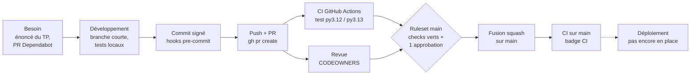

# Cartographie de la chaîne de valeur

> L'atelier A1 n'a pas été réalisé par le binôme. Cette cartographie a été construite après coup
> à partir du fonctionnement réel du dépôt (PR, revues, pipeline) et des durées mesurées sur GitHub.

Elle suit une modification du code, de l'idée jusqu'à `main`, et indique pour chaque étape
qui la fait, avec quel outil, et combien de temps elle prend.

## Le flux

## Les étapes

| # | Étape | Qui | Outils | Temps de travail | Temps d'attente |
|---|-------|-----|--------|------------------|-----------------|
| 1 | Besoin : énoncé du TP ou mise à jour proposée par Dependabot | Formateur, Dependabot | PDF, `dependabot.yml` | - | jusqu'à une semaine (Dependabot hebdomadaire) |
| 2 | Développement sur une branche courte | B, ou A selon le rôle | Python, `.venv`, `pytest`, Redis en conteneur | quelques minutes à 1 h | - |
| 3 | Commit conventionnel et signé | Auteur | Git, clé SSH ed25519, pre-commit (ruff, gitleaks) | quelques secondes | - |
| 4 | Push et ouverture de la PR | Auteur | `git push`, `gh pr create` | < 1 min | - |
| 5 | Pipeline CI : ruff, pre-commit, pytest avec couverture, en matrice | GitHub Actions | `.github/workflows/ci.yml` | ~1 min (2 jobs en parallèle) | - |
| 6 | Revue de la PR | Code owner (A pour `.github/`, B pour `app/`) | GitHub, `gh pr review` | quelques minutes | 0 à 38 min (voir ci-dessous) |
| 7 | Contrôle du ruleset puis fusion squash | Auteur | Ruleset `main`, `gh pr merge --squash` | < 1 min | - |
| 8 | Pipeline sur `main`, badge mis à jour | GitHub Actions | `ci.yml` (événement `push`) | ~1 min | - |
| 9 | Déploiement | - | aucun pour l'instant | - | - |

## Mesures réelles (durée entre l'ouverture et la fusion d'une PR)

| Période | PR | Ouverture → première revue | Ouverture → fusion |
|---------|----|----------------------------|--------------------|
| TP02 (ruleset, Dependabot, gitleaks) | #15 à #18 | 35 à 38 min | 36 à 38 min |
| TP02 (journal, secret) | #25 à #28 | 1 à 11 min | 2 à 12 min |
| TP03 (pipeline) | #29 à #35 | 0 à 4 min | 2 à 9 min |

Le pipeline lui-même ne prend qu'environ une minute : **le temps d'une modification est surtout
du temps d'attente de la revue humaine**, pas du temps de calcul.

## Goulots d'étranglement

- **La revue humaine** : jusqu'à 38 minutes d'attente quand le relecteur n'est pas disponible
  tout de suite. Avec un seul code owner sur `.github/`, son absence bloque toute PR sur ce dossier.
- **Les droits admin** : seul A peut modifier le ruleset (contrôles requis, désactivation temporaire).
- **pre-commit en CI** : 30 à 40 s par job, l'étape la plus longue du pipeline (installation des hooks, dont gitleaks).
- **Pas de déploiement** : le flux s'arrête à `main` ; rien n'est encore livré automatiquement.

## Améliorations possibles

- Ajouter un second code owner sur `.github/` pour ne pas dépendre d'une seule personne.
- Mettre en cache l'environnement pre-commit (`~/.cache/pre-commit`) pour réduire la durée du pipeline.
- Automatiser la livraison (image Docker, déploiement) dans les TP suivants, pour prolonger la chaîne jusqu'à la production.
